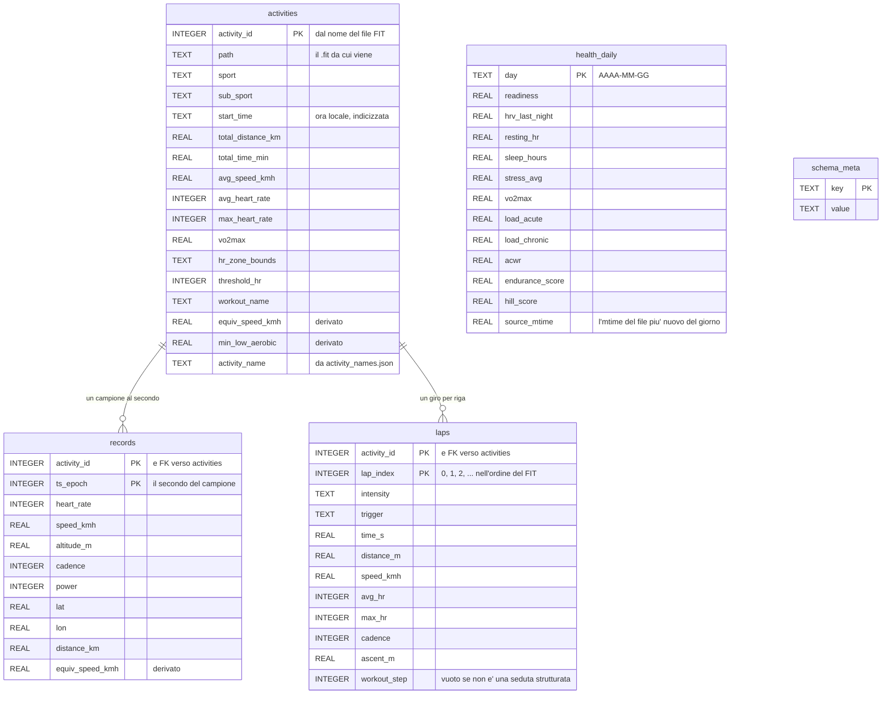

# I dati

Che cosa c'e' sul disco, dove, e da dove viene. Qui ci sono **i dati
scaricati** — i FIT delle attivita', i JSON di salute, il database che se ne
ricava — e **non i report**, che sono scritti dagli agenti e vivono in
`summary/` (vedi il README e `docs/service.md`).

I numeri sono una fotografia del **30 ottobre 2026**: servono a dare l'ordine
di grandezza, non sono un contratto.

## Dove stanno

Fuori dal repo, sotto una radice sola. Il puntatore e' `data.yaml` nella
radice del repo — l'unico file di configurazione che resta li', perche' e'
quello che deve trovare i dati:

```yaml
data_root: ~/adrive/data/training
```

Se la cartella che nomina non esiste il programma si ferma: **non la crea**.
Il perche' del confine sta nel README (`I dati stanno fuori dal repo`) e nel
todo 65.

## L'albero

| Cartella | Cos'e' | Quanto | In questo documento |
|---|---|---|---|
| `fit/` | i file originali delle attivita', scaricati da Garmin | 126 MB, 985 file | si' |
| `health/` | le metriche giornaliere, una cartella per endpoint | 260 MB, ~56.700 file | si' |
| `json/` | le cache di nomi e tipi, e le correzioni fatte a mano | 20 KB, 4 file | si' |
| `db/` | `activities.db`, la cache ricostruibile | 197 MB | si' |
| `user/` | `config.yaml`, `profile.yaml`, `avatar.jpg` | 48 KB | si' |
| `summary/` | i report scritti dagli agenti | 27 MB | no |
| `plan/` | i blocchi di allenamento scritti a mano | 32 KB | no |

C'e' anche `.refresh.lock`, un file vuoto: e' il lucchetto che impedisce a
due giri di report di sovrapporsi.

## Il confine: i file sono la fonte, il database e' derivato

Una regola sola, e vale per tutto quello che segue:

> **I file scaricati sono la fonte. `activities.db` si puo' buttare e
> rifare.**

Le attivita' si ricostruiscono dai `.fit`, la salute dai JSON di `health/`.
L'unica cosa che un rebuild **perderebbe** sono le correzioni fatte a mano —
il terreno e il tipo di corsa — ed e' esattamente per questo che non stanno
in tabella ma in `json/`, dove nessun rebuild le tocca.

Il contrario non vale: un dato che sta solo in tabella e non nei file non
esiste. I giri di una seduta sono l'esempio — la tabella `laps` e' nata vuota
col todo 79 e si e' riempita solo rileggendo i FIT.

## I file

### `fit/` — le attivita'

Un file per attivita', `<activity_id>_ACTIVITY.fit`, estratto dallo zip che
manda Garmin. 985 file, in media 128 KB, il piu' grande 957 KB. Vanno dal
**16 novembre 2014** al **29 ottobre 2026**.

Li scarica `make update_activity`, che chiede l'elenco attivita' dalla piu'
recente alla piu' vecchia e **si ferma alla prima che ha gia'**: lo storico
intero e' un'altra cosa (`make backfill FROM=... TO=...`).

Dentro un FIT ci sono i messaggi che contano per noi:

| Messaggio | Dove finisce |
|---|---|
| `session` | una riga di `activities` (il riassunto della seduta) |
| `record` | le righe di `records` (un campione al secondo) |
| `lap` | le righe di `laps` (un giro per riga) |
| 140, campo 7 | `activities.vo2max` (lo scrive il motore Firstbeat) |

**Sei file sono sotto i 2 KB** (il piu' piccolo 226 byte): attivita' vecchie
registrate da dispositivi che non scrivevano niente, o troncate. Si leggono
senza errori e danno una riga quasi tutta vuota.

**Nome e tipo dell'attivita' non stanno nel FIT**: arrivano solo con
l'elenco attivita' di Garmin Connect, e per questo si tengono in `json/`.

### `health/` — le metriche giornaliere

Undici endpoint, una cartella per endpoint, **un file per giorno** chiamato
`<AAAA-MM-GG>.json`. Li scrivono `make update_activity` (gli ultimi
`health_refresh_days`, cioe' 3), `make backfill_health` (lo storico da
`history_start`) e `make backfill FROM=... TO=...`.

| Cartella | Chiamata di Garmin | File | Da |
|---|---|---|---|
| `stats/` | `get_stats` | 6.147 | 2010-01-01 |
| `sleep/` | `get_sleep_data` | 6.147 | 2010-01-01 |
| `stress/` | `get_stress_data` | 6.147 | 2010-01-01 |
| `hrv/` | `get_hrv_data` | 6.147 | 2010-01-01 |
| `spo2/` | `get_spo2_data` | 6.146 | 2010-01-01 |
| `respiration/` | `get_respiration_data` | 6.146 | 2010-01-01 |
| `resting_heart_rate/` | `get_rhr_day` | 6.146 | 2010-01-01 |
| `training_readiness/` | `get_training_readiness` | 6.146 | 2010-01-01 |
| `training_status/` | `get_training_status` | 6.146 | 2010-01-01 |
| `endurance_score/` | `get_endurance_score` | 668 | 2025-01-01 |
| `hill_score/` | `get_hill_score` | 668 | 2025-01-01 |

Il piu' pesante e' `sleep/` (46 MB): un file di sonno sono ~150 KB, perche'
dentro c'e' la notte minuto per minuto. `stats/` sta sotto i 6 KB.

**Un file c'e' anche quando il dato non c'e'.** I 6.147 file di `hrv/`
partono dal 2010, ma l'orologio e' arrivato molto dopo: un giorno senza
misura ha i campi a `null` — a volte `null` al posto di un dizionario intero.
Per questo ogni campo passa da `_dig()`, che su qualunque sorpresa torna
`None`. Vedi i numeri veri in [Lo storico, in numeri](#lo-storico-in-numeri).

**Un file conta come completo solo se e' stato salvato dopo la fine del suo
giorno** (todo 39). Uno salvato a meta' giornata non ha quello che Garmin
aggiunge dopo — il VO2max e il carico di una corsa della sera, il body
battery piu' basso, lo stress del giorno — e si riscarica al giro
successivo. Oggi si riscarica sempre.

Fuori dalle cartelle c'e' **`health/lactate_threshold_latest.json`**, un file
unico riscritto a ogni `update_activity`. La soglia del lattato non e' un
dato giornaliero: Garmin la da' solo il giorno in cui ne rileva una nuova,
quindi si tiene l'ultima. Il backfill non la scarica — l'ultima soglia di
oggi scritta sui giorni passati sarebbe falsa.

### `json/` — due cache e due correzioni

Quattro file piccoli, tutti dizionari `activity_id -> valore`. **Due cose
diverse nella stessa cartella**, e la differenza conta:

| File | Cos'e' | Chi lo scrive | Voci |
|---|---|---|---|
| `activity_names.json` | il nome dell'attivita' su Connect | il download | 17 |
| `activity_types.json` | il `typeKey` di Connect (`running`, `road_biking`, ...) | il download | 17 |
| `activity_terrain.json` | il terreno **corretto a mano** | la pagina React | 8 |
| `activity_run_type.json` | il tipo di corsa **corretto a mano** | la pagina React | 6 |

I primi due sono **cache di dati scaricati**: servono perche' nome e tipo non
stanno nel FIT, e si riempiono solo per le attivita' scaricate da quando la
cosa esiste — 17 su 985. `make backfill_activity_names` chiede a Garmin
quelle che mancano.

Gli altri due sono **gli unici dati che questo progetto crea e che un
rebuild non deve perdere**. Il terreno (`track`, `road`, `gravel`, `trail`,
`mountain`) e il tipo di corsa (`race`, `intervals`, `long`, `tempo`,
`easy`) l'API li stima (`interface/terrain.py`, `interface/run_type.py`) e li
si corregge dalla vista Training della Day: le correzioni stanno qui e non in
`activities.db` proprio per questo (todo 35, 36, 62).

### `user/` — chi sono e come si scarica

| File | Cos'e' |
|---|---|
| `config.yaml` | token di login, fuso orario, inizio dello storico, pausa fra le richieste, le finestre in giorni. Tutte le chiavi obbligatorie, nessun default nel codice |
| `profile.yaml` | i dati personali presi da Garmin (`userprofile-service`): id, nome, data di nascita, altezza, peso |
| `avatar.jpg` | l'immagine del profilo |

## Il database

`db/activities.db`, 197 MB, SQLite. Quattro tabelle di dati piu' una di
servizio. E' **tutta cache**: `activities`, `records` e `laps` vengono dai
FIT, `health_daily` dai JSON di `health/`.

| Tabella | Righe | Da |
|---|---|---|
| `activities` | 985 | un `.fit` per riga |
| `records` | 2.697.703 | i messaggi `record` dei FIT |
| `laps` | 6.243 (su 983 attivita') | i messaggi `lap` dei FIT |
| `health_daily` | 6.147 | gli undici JSON di un giorno |
| `schema_meta` | 2 | le versioni della logica di parsing |

### Schema ER



**`health_daily` non ha chiavi esterne verso `activities`**, e non e' una
dimenticanza: le due meta' del database stanno nello stesso file ma non si
toccano. Si incontrano sul giorno, in Python, quando una pagina mette il
carico accanto alla seduta che l'ha prodotto. Il motivo e' quello di sopra:
un cambio al parsing della salute svuota `health_daily` e basta, senza
rileggere 985 FIT.

Le due relazioni vere sono `ON DELETE CASCADE`, e `records` e `laps` sono
`WITHOUT ROWID` con chiave composta: in `records` ci sono 2,7 milioni di
righe, e la riga **e'** la sua chiave.

### `activities` — 27 colonne

Il riassunto `session` del FIT, piu' quattro cose che il FIT non dice.
Quelle **non scaricate**, cioe' calcolate da noi:

| Colonna | Da dove viene davvero |
|---|---|
| `equiv_speed_kmh` | la velocita' equivalente in piano, dai record (`interface/grade.py`). A `NULL` sul tapis roulant: il modello di costo vale per chi si muove sul terreno |
| `min_low_aerobic`, `min_high_aerobic`, `min_anaerobic` | i minuti nelle tre fasce di sforzo, contati dai `records` coi confini di **quella** seduta. Un buco fra due campioni oltre 30 secondi non e' tempo allenato (todo 54) |
| `threshold_hr` | del FIT, ma dove manca o e' zero si prende quella della corsa piu' vicina, dal 2026-08-01 in poi |
| `activity_name` | `json/activity_names.json`, riscritta a ogni sync |
| `sport` | del FIT, ma `activity_types.json` la corregge, e **`sub_sport = treadmill` vince su tutto** (todo 45) |
| `parsed_at` | quando l'abbiamo letta |

Gli sport in tabella, oggi:

| Sport | Attivita' |
|---|---|
| `running` | 336 |
| `cycling` | 216 |
| `hiking` | 213 |
| `cross_country_skiing` | 113 |
| `walking` | 67 |
| `treadmill` | 23 |
| `swimming` | 5 |
| `mountaineering` | 4 |
| `generic` | 3 |
| `training` | 2 |
| `alpine_skiing`, `rock_climbing`, `snowboarding` | 1 ciascuno |

I tre `generic` sono attivita' registrate seguendo un percorso preimpostato,
che nel FIT finiscono senza sport e per cui Connect non ha dato un tipo.

### `records` — la seduta secondo per secondo

2,7 milioni di righe, in media 2.700 per attivita': sono il grosso dei 197
MB. Le posizioni arrivano dal FIT in semicerchi e si salvano in gradi.
`equiv_speed_kmh` e' derivata anche qui, campione per campione, per il
grafico Speed della scheda.

### `laps` — com'era fatta la seduta

Un giro per riga, con intensita', tempo, distanza, velocita' e battiti
(todo 79). Servono a una cosa sola: mostrare la forma di una seduta — il
riscaldamento, le ripetute una per una, i recuperi, il defaticamento.

Si distingue una seduta strutturata da una corsa libera dal **`workout_step`,
non dall'intensita'**: i giri di una corsa libera sono l'auto-lap al
chilometro e quel campo e' vuoto. `cadence` e' quella del FIT, le falcate di
una gamba al minuto: chi corre ne fa il doppio.

### `health_daily` — 33 grandezze per giorno

Una riga per giorno, costruita aprendo tutti e undici i JSON di quel giorno.
**`NULL` vuol dire "non lo sappiamo", mai zero**: uno zero direbbe "battito a
riposo zero", che e' falso.

| Da quale file | Colonne |
|---|---|
| `training_readiness/` | `readiness` — e solo il punteggio **al risveglio** (`AFTER_WAKEUP_RESET`), che in un giorno ce n'e' piu' d'uno |
| `stats/` | `body_battery_low`, `body_battery_high` |
| `hrv/` | `hrv_last_night`, `hrv_weekly_avg`, `hrv_status` |
| `resting_heart_rate/` | `resting_hr` |
| `sleep/` | `sleep_hours` (convertito dai secondi), `sleep_score` |
| `stress/` | `stress_avg`, `stress_max` |
| `respiration/` | `resp_sleep_avg`, `resp_waking_avg`, `resp_low`, `resp_high` |
| `spo2/` | `spo2_avg`, `spo2_low`, `spo2_sleep_avg` |
| `training_status/` | `vo2max`, `vo2max_date`, `training_status`, `training_status_phrase`, `load_acute`, `load_chronic`, `acwr`, `acwr_status`, `load_aerobic_low`, `load_aerobic_high`, `load_anaerobic`, `load_balance_phrase` |
| `endurance_score/` | `endurance_score`, `endurance_level` |
| `hill_score/` | `hill_score` |

Piu' `source_mtime` e `parsed_at`, che sono il meccanismo della cache:
`source_mtime` e' l'mtime del file piu' nuovo del giorno, ed e' **quello che
fa rileggere un giorno** quando Garmin lo rivede.

**Dei JSON si tiene solo il valore giornaliero.** Le serie minuto per minuto
— stress, respiro, sonno — si leggono e si buttano: restano nei file per chi
le vuole intere, e `garmin/fitness_status.py` se le legge da se'.

### `schema_meta` — le due versioni

| Chiave | Valore oggi | Governa |
|---|---|---|
| `logic_version` | `9` | il parsing dei FIT (`interface/db.py`) |
| `health_logic_version` | `2` | il parsing della salute (`interface/health_db.py`) |

## Come si ricostruisce

Non c'e' un comando da lanciare: **se lo fa da se'**. Qualunque lettura passa
da `sync()` per i FIT e da `sync_health()` per la salute, e ognuno confronta
la sua versione con quella in `schema_meta`.

| Cosa succede | Cosa fa |
|---|---|
| Un `.fit` nuovo | lo legge e aggiunge le righe. Il resto non si tocca |
| `logic_version` diversa | **butta il file intero** e rilegge tutti i 985 FIT |
| Un file di salute piu' nuovo della riga | rilegge quel giorno |
| `health_logic_version` diversa | ricrea `health_daily` vuota e la rifa' dai JSON |

Un rebuild dei FIT porta via anche `health_daily`, perche' cancella il file:
va bene, il primo `sync_health()` dopo la riempie di nuovo. L'inverso no, ed
e' il motivo per cui le due versioni sono separate.

Rileggere i 985 FIT e' lavoro locale — nessuna chiamata a Garmin — quindi
alzare `LOGIC_VERSION` e' una cosa che si fa senza paura. **Rifare i 260 MB
di `health/` no: quelli sono quasi 57.000 chiamate a Garmin**, e si
riscaricano solo i giorni che mancano. Un anno di storico sono 30-45 minuti.

I minuti per zona sono l'eccezione: si ricalcolano dai record con
`make backfill_zones`, senza toccare ne' Garmin ne' i FIT.

## Lo storico, in numeri

I file partono dal 2010 perche' e' quello che si e' chiesto a Garmin. I dati
veri cominciano quando c'e' stato un orologio al polso:

| Grandezza | Primo giorno con un valore | Giorni misurati |
|---|---|---|
| Attivita' (FIT) | 2014-11-16 | 985 attivita' |
| `resting_hr` | 2018-10-04 | 2.610 |
| `readiness` | 2025-09-09 | 417 |
| `endurance_score`, `hill_score` | 2025-01-01 (inizio dello storico) | 668 file |

I buchi sono veri e si devono vedere: dal 1 all'8 settembre 2026 `sleep` e
`stats` hanno i campi a `null`, e dal 4 all'8 `hrvSummary` e' `null` tutto
intero. In tabella diventano `NULL`, nei grafici una linea interrotta.

## Cosa Garmin non da'

Tre cose che si cercano e non ci sono, perche' costano tempo ogni volta che
uno le ricerca:

- **Il terreno di un'uscita a piedi.** Non esiste come campo. Si stima dal
  tipo e dalla salita per km, e si corregge a mano dalla pagina: asfalto e
  sterrato si annotano da se'.
- **Il tipo di una corsa.** Si stima dall'allenamento pianificato salvato nel
  FIT e dalla durata. Gara non si stima mai.
- **Una distanza credibile sul tapis roulant.** L'orologio la indovina dal
  polso e in salita sbaglia di molto. Resta in tabella e **non la mostra ne'
  la somma nessuno**: l'API la manda a `null` insieme alla velocita' media.

E una quarta, piu' banale: **il nome e il tipo di un'attivita' non stanno nel
FIT**. Senza `json/activity_names.json` sono 968 attivita' senza nome.

## Il login

`garminconnect`, la libreria open source che replica le chiamate dell'app
mobile. **Non e' un'API ufficiale**: si puo' rompere quando Garmin cambia i
suoi endpoint interni. Le credenziali non si salvano: si salva un token, nel
percorso che dice `token_store` in `user/config.yaml` (`~/token`).

Il primo scarico di tutto, prima che il progetto fosse un progetto, lo faceva
`export/garmin_export_all.py`, uno script a se' stante, e piu' tardi il
comando `garmin-export-all`. Non ci sono piu' ne' l'uno ne' l'altro: i file
sono scaricati, e a tenerli aggiornati bastano i target del Makefile. Il
comando scriveva in `activities/` e `misc/`, due cartelle che nessun lettore
di questo progetto ha mai aperto.
