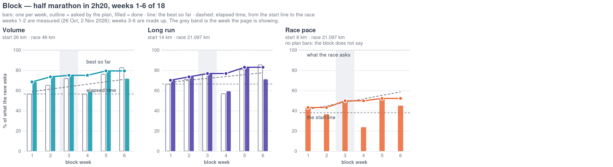

# Aderenza e risposta, separate

Da dove viene: una conversazione del 9 novembre 2026, partita da «un grafico
sotto la Training della settimana che dica se sono in pari col piano», e
`docs/aderenza.md`, scritto lo stesso giorno. Il documento decide la cosa che
il grafico da solo non poteva decidere:

> Due misure separate, da non fondere in un numero unico.
>
> 1. **Aderenza**: quanto stai seguendo il piano (l'esecuzione).
> 2. **Risposta**: quanto il piano sta funzionando (il risultato).

Oggi la Week non dice ne' l'una ne' l'altra. La vista Training mette il
previsto e il fatto affiancati (todo 73) e lascia il confronto all'occhio: le
sette righe del piano a sinistra, le sedute a destra, e il lettore che tiene a
mente che «14 km» previsti e «14.8 km» fatti sono la stessa seduta andata
bene. Funziona per una settimana. Per diciotto no, e la domanda vera — *sto
arrivando dove il blocco voleva portarmi* — non la risponde nessuno.

Questo todo fa le due misure, **separate anche nel codice e a schermo**: un
grafico per la risposta, due numeri per l'aderenza. Niente punteggio unico.
Il motivo e' quello del documento: se l'aderenza e' alta e la risposta non
arriva va cambiato il piano; se l'aderenza e' bassa il piano non e' stato
messo alla prova. Un numero solo non distingue i due casi, e sono i due casi
in cui si fa qualcosa di diverso.

---

## 1. La risposta: i tre pannelli del blocco

Tre pannelli affiancati, in fondo alla vista Training della Week, uno per KPI.
Sull'asse x la **settimana del blocco**, da 1 a `block_weeks`; sull'asse y la
**percentuale di quello che la gara chiede**, zero a cento, **la stessa per
tutti e tre**: e' l'asse condiviso a rendere i tre KPI confrontabili a
occhio, che era il motivo di normalizzare.

**Il grafico batte una volta a settimana.** Ogni settimana porta la sua barra —
quanto ha chiesto il piano, quanto hai fatto — e sopra le barre corrono le
linee. Senza le barre il ritmo del blocco non si vede: il cricchetto e' per
costruzione una scala che non scende, e le quattro settimane di scarico, che
sono una scelta del piano e non un incidente, sparirebbero dal disegno.



Il mockup: **settimane 1 e 2 misurate** (26 ottobre e 2 novembre 2026), 3-6
inventate per far vedere come si legge — compreso uno scarico alla quarta e
una settimana storta alla sesta. Lo fa `assets/96_block_mockup.py`, che
costruisce le specifiche Vega-Lite e le rende con il `vl2svg` del frontend:
non e' un disegno che somiglia al grafico, e' il grafico con dentro dei numeri
finti. Si rifa' con:

```bash
uv run --with cairosvg python todo/assets/96_block_mockup.py
```

### I tre KPI

| KPI | misura | sorgente |
|---|---|---|
| **Volume** | i km di corsa della settimana | `activities`, `sport = running` |
| **Long run** | la corsa singola piu' lunga della settimana | la stessa |
| **Race pace** | il tratto continuo piu' lungo a velocita' equivalente >= `target_speed_kmh` | `records.equiv_speed_kmh`, solo `running` |

Sono tre cose diverse — quanto corri, quanto a lungo, quanto in fretta — e
nessuna delle tre si puo' dedurre dalle altre due.

**Il tapis roulant resta fuori da tutte e tre.** La prima stesura di questo
todo lo faceva contare nel volume — «una corsa da 7 km fatta sul nastro e'
quella seduta, fatta» — e nel race pace no. Ma il progetto ha gia' deciso
altrimenti e da piu' lontano: `sports.DISTANCELESS_SPORTS` lo chiama sport
senza distanza (todo 45), perche' sul nastro i chilometri li stima il polso e
in salita sbagliano di molto, e `has_distance` li esclude da **ogni** somma.
Un blocco che si misura in chilometri non puo' contare chilometri che nessuno
ha misurato. Cosi' i tre KPI leggono tutti `sport = running` e il rischio di
due somme che non tornano, scritto piu' sotto, non esiste.

**Il race pace e' il KPI della velocita', e la velocita' non lo e'.** Il
candidato ovvio — la velocita' equivalente migliore della settimana — e' morto
prima di nascere: il 30 settembre 2026, prima che il blocco cominciasse, Andrea
ha corso 5 km a 9.38 km/h equivalenti, cioe' **sopra** il bersaglio di 9.04. Un
KPI inchiodato al 100% dalla settimana 1 non dice niente. Morto anche il
secondo candidato, il passo medio della settimana: misura il **miscuglio delle
sedute**, non la forma. La settimana del 19 ottobre segna 6'43" — il passo piu'
veloce dell'autunno — ed era la settimana peggiore del gruppo: tre corse corte
e forti, nessuna lunga, e lo sforzo lungo era un'escursione di 6h20 il sabato,
cioe' la cosa che il blocco vieta. Poi la settimana 1 rallenta a 7'10" perche'
arriva la lunga da 14.8 km. Il blocco e' **fatto** per peggiorare il passo
medio: dalla settimana 1 alla 14 la lunga va da 14 a 21 km, tutti chilometri
lenti per scelta. Una barra di progresso costruita su quel numero scenderebbe
per diciotto settimane e premierebbe le settimane di cutback.

Quello che resta e' il gap che il blocco dichiara di suo, in
`plan/half_marathon_2.20.md`: «You have never run at 6'38" for more than
8 km». Misurato dai record, quel numero e' esatto — il tratto piu' lungo sopra
9.04 km/h era 8.0 km, il 25 ottobre, e il 27 ottobre e' diventato 9.1. Il
bersaglio e' 21.097 km, cioe' la gara.

### Il cricchetto

Il punto di ogni settimana e' **il migliore fino a quella settimana**, non il
valore della settimana corrente. Sale su un record e resta fermo altrimenti.

Non e' un abbellimento, e' obbligatorio: i km previsti dal blocco sono una
sega — 26, 30, 33, **26**, 35, 38, 41, **31**, 38, 42, 44, **34**, 42, 46, 43,
38, **29**, 33 — con quattro discese volute, le settimane di cutback e lo
scarico. Una linea «km della settimana / 46» scenderebbe quattro volte su
diciotto e si leggerebbe come un crollo quando e' il piano che funziona. Il
cricchetto le toglie di mezzo e rende le linee monotone, cioe' confrontabili
con una diagonale.

Si vede subito sul race pace: 9.1 km alla settimana 1, poi 7.7 alla 2 perche'
la lunga del 7 novembre andava piano come doveva. Il cricchetto tiene 9.1.

### La partenza e il bersaglio

Due formule, e vanno tenute distinte perche' una e' l'asse e l'altra e' un
numero.

**L'asse e' sul bersaglio**, non sul guadagno:

```
y = valore / bersaglio
```

Cosi' una barra non puo' andare sotto zero, ed e' la cadenza settimanale a
pretenderlo: la settimana 4 chiede 26 km, cioe' **esattamente** la riga di
partenza, e una settimana con un acciacco ci va sotto. Con l'asse ancorato
alla partenza quelle barre sarebbero zero e negative — una settimana di
scarico disegnata come un fallimento, e una settimana persa che sfonda la
scala (zero km di corsa farebbe `-130%`). Sul bersaglio sono barre basse, che
e' quello che sono.

**Il progresso resta, come numero**, nel tooltip e nei riquadri:

```
progresso = (migliore finora - partenza) / (bersaglio - partenza)
```

E' la risposta a «sono in pari», e si legge anche nel disegno: e' la distanza
fra la linea del cricchetto e la **riga della partenza**, che si disegna
orizzontale. Spostare l'ancora dell'asse non la cancella, la mette dove non
deforma le barre.

Una regola sola per la partenza: **quella che il piano dichiara per la
settimana 1 del blocco, e se non la dichiara la migliore delle quattro
settimane misurate prima di `block_start`**.

| KPI | partenza | da dove | bersaglio | da dove |
|---|---|---|---|---|
| Volume | 26 km | km previsti, settimana 1 | 46 km | `peak_weekly_km` |
| Long run | 14 km | lunga prevista, settimana 1 | 21.097 km | `distance_km` |
| Race pace | 8.0 km | misurato, 25 ottobre | 21.097 km | `distance_km` |

La partenza **non** e' la media delle settimane prima del blocco, che era
l'altra candidata. Due motivi, misurati: le quattro settimane prima facevano
28.05 km di media e la settimana 1 del blocco ne chiede 26, quindi il
progresso previsto della prima settimana sarebbe **-11%** — il blocco ti
inizia piu' piano di come andavi, ed e' giusto, ma un piano che parte in
ritardo su se stesso non si spiega a schermo; e quella media dipende da quante
settimane indietro si guarda, cioe' da una costante che nessuno ha motivo di
scegliere. Con la partenza dal piano, il progresso previsto parte da **zero**
per costruzione.

Da quando l'asse e' sul bersaglio, la scelta della partenza **non deforma piu'
il disegno**: sposta la riga orizzontale e il numero nel tooltip, non le barre.
E' il motivo per cui questa decisione, che prima era la piu' delicata del
grafico, adesso si puo' cambiare senza rifare niente.

### Le barre e le linee, per pannello

Ogni pannello ne porta cinque, ed e' lo stesso disegno per tutti e tre:

- **due barre per settimana**: `plan` come contorno, `done` piena nella tinta
  del KPI. Sono la cadenza. Una settimana senza niente da misurare non
  disegna la sua barra — non la disegna a zero (e' la regola delle settimane
  vuote del Trend: un buco si spezza, non si attraversa);
- **la linea del cricchetto**, piena, che e' il progresso;
- **la riga della partenza**, orizzontale e sottile: volume al 57% (26 su 46),
  long run al 66% (14 su 21.097), race pace al 38% (8 su 21.097). Sopra quella
  riga c'e' il guadagno del blocco, sotto no;
- **Elapsed time**, grigia tratteggiata, dalla partenza alla gara: da
  `(0, partenza)` a `(block_weeks, 100%)`. L'origine e' la settimana **zero**,
  non la uno: all'inizio della settimana 1 non e' passato niente, e il punto
  della settimana `n` e' la sua fine.

Il cricchetto previsto non si disegna come linea a parte: le barre `plan`
dicono la stessa cosa con la cadenza dentro, e una sesta serie per pannello
era rumore. Il confronto col piano resta quello che conta, e si legge fra la
linea piena e il contorno delle barre.

**La diagonale non e' il giudice, e va detto perche' e' controintuitivo.** Il
piano non sale come il tempo: fa 57, 65, 72, 57, 76, **83%** di volume nelle
prime sei settimane contro 59, 61, 64, 66, 69, **71%** della diagonale, e
arriva al suo massimo alla **settimana 14** — il volume esattamente al 100%
(46 km = `peak_weekly_km`), la lunga al 99.5% (21 km su 21.097, che il blocco
non ti fa mai correre la gara prima della gara). Dopo c'e' lo scarico, e le
barre scendono per scelta. Chi leggesse solo la diagonale si direbbe «in
anticipo» per tutto l'autunno e «in ritardo» da febbraio senza aver cambiato
niente.

Il race pace ha le barre `done` e **non quelle `plan`**: il front matter delle
sedute non porta i km a ritmo gara, quel lavoro vive solo nella prosa («the
last 5 km at race pace», settimana 10). Il suo pannello resta con la
diagonale e la riga della partenza, e la didascalia lo dice. La chiave che lo
sistemerebbe e' in fondo, sotto «Non in questo todo».

La settimana che la pagina sta mostrando si marca in tutti e tre i pannelli
con una riga verticale: il grafico e' del blocco, l'intestazione e' della
settimana, e senza il segno non si sa dove si e'.

**Tre pannelli e non un grafico solo.** Con la cadenza settimanale un grafico
unico vorrebbe cinquantaquattro barre e sette linee, e la lettura morirebbe
verso la settimana dieci. I tre pannelli condividono l'asse y, il dominio e la
riga del passaggio, che e' come si leggono di fianco i cinque pannelli del
Trend: il confronto fra KPI sopravvive nella scala condivisa, non
nell'affollamento. La macchina dei pannelli c'e' gia' (`_panel_charts`,
`TrendPanels` reso riusabile dal todo 78).

---

## 2. L'aderenza: due numeri per settimana

Dal documento, e non reinventati qui. Per ogni seduta prevista:

```
r = fatto / previsto
s_vol = max(0, 1 - |ln r| / ln 2)
```

Uno se fai esattamente il previsto, zero se fai il doppio o la meta', e
simmetrico in scala logaritmica: **strafare pesa quanto fare meno**. E' la
parte che cambia la lettura delle due settimane misurate, dove il sommario
della conversazione diceva «+21%» e «+13%» come se fossero buone notizie.

Il previsto e' in **chilometri** e non in carico ne' in durata: il documento
dice «carico o, se manca, durata», ma un blocco di corsa e' pianificato in km
e i km sono nel front matter (`distance_km`). Un intervallo (`[10, 11]`) si
riduce al suo centro, come fa gia' `_distance_label`.

### L'abbinamento

Una seduta prevista si cerca **nel suo giorno**; se quel giorno non ha una
corsa, nei due giorni accanto, e vince il piu' vicino fra quelli non ancora
abbinati. Il documento lo lascia come domanda aperta (`+/-1 giorno?`): si
risponde cosi' perche' senza finestra una seduta spostata di un giorno viene
punita due volte — zero sul giorno previsto **e** un'eccedenza sul giorno in
cui e' stata fatta. Nelle due settimane misurate la finestra non serve, ogni
seduta e' caduta sul suo giorno: serve alla prima settimana con un acciacco.

- prevista e non fatta: `s_vol = 0`;
- fatta e non prevista: nessun punteggio, ma entra nel rapporto;
- riposo previsto e rispettato: fuori dalla media, non c'e' niente da
  eseguire;
- riposo previsto con un allenamento al suo posto: seduta non prevista, come
  sopra. La bici facoltativa (`optional: cycling`) non e' una seduta prevista
  e non entra da nessuna parte: e' permesso, non richiesto.

### Il punteggio della settimana

```
peso_i   = km_previsti_i * (2 se chiave, 1 altrimenti)
aderenza = 100 * sum(peso_i * s_vol_i) / sum(peso_i)
```

Chiave e' `kind in ("long", "quality")`: il documento dice «lungo, ripetute,
test», e il vocabolario del piano ha `easy | quality | long`.

La pesatura non e' un dettaglio. Martedi' 27 ottobre era prevista `easy 5 km`
e sono stati corsi 9.1 km a ritmo gara: `r = 1.82`, `s_vol = 0.14` — ed e' la
seduta che ha fatto il record di race pace del blocco, cioe' il record e'
arrivato **disobbedendo**. Pesata sui km previsti quella seduta vale 5 su 47,
e la settimana chiude a 82 invece di 72. La formula si comporta bene su dati
veri: le sedute piccole non dominano.

Accanto, sempre, il rapporto:

```
rapporto = km corsi nella settimana (anche non previsti) / km previsti
```

L'aderenza dice **come** hai eseguito, il rapporto se sei sopra o sotto. Due
numeri, non uno: 82 con rapporto 1.21 e 82 con rapporto 0.83 sono settimane
opposte.

### Si chiama "volume adherence", non "adherence"

Il documento definisce `seduta = (s_vol + s_int) / 2`, e `s_int` e' la
somiglianza fra la distribuzione del tempo nelle zone prevista e quella
fatta. **Oggi non si puo' calcolare**: il front matter delle sedute ha
`sport`, `kind`, `distance_km`, `optional`, e non le frazioni per zona. Le
fasce stanno nella tabella `## Paces` della prosa, e il legame `kind` ->
fascia non e' scritto a macchina da nessuna parte.

Quindi si spedisce meta' misura, **chiamandola col suo nome**: il campo e'
`volume_adherence`, a schermo «Volume adherence», e la didascalia dice che
l'intensita' non c'e' ancora. Un numero chiamato `adherence` che vale la
meta' della sua definizione e' il tipo di bugia che fra sei mesi nessuno
ricorda di aver detto.

---

## Dove stanno a schermo

Vista **Training** della Week, che e' dove stanno il previsto e il fatto (todo
68 e 73).

- **La risposta**: una card nuova a tutta larghezza, titolo `Block`, coi tre
  pannelli in fila dentro (in colonna sotto i 900 px, come fa `.week-work`),
  **sotto** `.week-work`. Sotto e non sopra: il verdetto della settimana e' il commento
  in cima (todo 74), poi i sette giorni, e il blocco e' la cornice larga —
  l'ultima cosa che si guarda, non la prima.
- **L'aderenza**: due riquadri `Stat` in cima alla card del piano
  (`WeekPlanBrief`), che e' la colonna del previsto. `Volume adherence` 0-100
  e `Done / planned` come rapporto. Niente barra della fascia: non c'e' una
  fascia a dodici settimane per queste due misure, e non si inventa.
- **Per seduta**: il punteggio sulla riga del giorno nel piano, piccolo e a
  destra, dove la riga dice gia' cosa chiedeva quel giorno. E' il posto dove
  «previsto 5, fatto 9.1, 14» si legge in una riga sola.

Una settimana fuori da un blocco (prima di `block_start`, o senza file di
piano) non mostra la card `Block` e non mostra i due riquadri: una didascalia,
come fa gia' `WeekPlanBrief` quando il piano non c'e'.

Una settimana il cui `plan:` **non** e' il goal attuale segue **il suo**
piano, non quello attuale: le settimane scritte sono il registro di quello che
era previsto allora (e' la regola di `weeks_following`).

---

## Work

### 1. I dati — `src/training/interface/block_data.py`, nuovo

Un modulo nuovo e non dentro `weekly_data.py`: quello risponde su **una**
settimana, questo legge diciotto settimane di piano e tutte le corse del
blocco. Sono due domande, e `weekly_data.py` e' gia' a 750 righe.

- `race_pace_km(records, target_kmh)` — il tratto continuo piu' lungo a
  velocita' equivalente >= `target`. Non si cerca a coppie di punti (e'
  O(n^2), misurato: due minuti per trenta corse). La condizione
  `(d[k]-d[i]) / (t[k]-t[i]) >= v` si riscrive `g[k] >= g[i]` con
  `g = distanza - v * tempo`, e allora per ogni `i` basta l'ultimo `k` con
  `g[k] >= g[i]`, che si trova in binaria sul massimo suffisso di `g` — il
  massimo suffisso e' non crescente. O(n log n), istantaneo.
- `block_weeks(summary_dir, monday)` — le settimane del blocco a cui appartiene
  `monday`: si legge il suo file, si prende `plan` e `block_weeks`, e si
  raccolgono i file delle settimane da `block_week` 1 a `block_weeks` con lo
  stesso `plan`. I km e la lunga previsti per settimana vengono da
  `sessions[].distance_km`.
- `adherence(plan_sessions, activities)` — l'abbinamento, `s_vol` per seduta, il
  punteggio pesato e il rapporto.
- `block_progress(...)` — i cricchetti previsto e fatto, le percentuali e la
  diagonale.

La partenza e il bersaglio vengono da `plan/<slug>.md` via `load_plans`:
`target_speed_kmh`, `peak_weekly_km`, `distance_km`. Un piano che non li ha
rende il KPI corrispondente a `None`, e la linea non si disegna: e' la regola
del front matter facoltativo di `plans.py`, «un piano che non si vede perche'
gli manca una chiave sarebbe peggio di un piano senza numeri in cima».

### 2. La cache del race pace — `src/training/api/cache.py`

`race_pace_km` legge i `records` di ogni corsa del blocco: a blocco pieno sono
~54 corse da 3-5 mila campioni, circa un quarto di milione di righe per
richiesta. Un `_Cached` nuovo, chiave `(activity_id, target_kmh)`, **senza
TTL**: un'attivita' gia' letta non cambia piu'. Si svuota da `invalidate`,
come gli altri.

Non una colonna in `activities`: il numero dipende dal bersaglio del goal, che
non e' una proprieta' dell'attivita'. Se la cache non bastasse, la mossa dopo
e' una colonna con la **curva** velocita'-distanza, che e' indipendente dal
bersaglio — ma vuole `LOGIC_VERSION` e un `make rebuild`, e questo todo non li
tocca.

### 3. L'API — tre rotte

Tutte sotto `/api/weekly/{monday}/...`, quindi **nessuna trappola d'ordine**:
hanno due segmenti o piu' e non possono finire dentro `/api/weekly/{monday}`.
La guardia e' quella di `get_week_plan` e non `_week_monday`: **una settimana
futura e' legittima** qui, come per il piano — il blocco e' scritto in
anticipo e la vista Training si apre anche in avanti (todo 88).

- `GET /api/weekly/{monday}/block` -> `BlockProgress`: un KPI per pannello, e
  per ogni settimana del blocco il valore previsto e quello fatto (le barre),
  il cricchetto, le percentuali, e la diagonale. Ogni pannello porta la sua
  partenza e il suo bersaglio. 404 se la settimana non sta in un blocco.
- `GET /api/weekly/{monday}/block/charts/vega` -> **una specifica per
  pannello**, con `theme`. Plurale come
  `/api/weekly/trend/charts/vega` e per lo stesso motivo: tre pannelli in una
  risposta sola, che si disegnano insieme o non si confrontano.
- `GET /api/weekly/{monday}/adherence` -> `Adherence`: `volume_adherence`,
  `ratio`, e una voce per seduta prevista (giorno, tipo, km previsti, km
  fatti, `r`, `s_vol`, se e' chiave, il giorno in cui e' stata fatta se non e'
  il suo). 404 se la settimana non ha un piano.

Modelli in `models.py` accanto ai `Week*`. Niente conti nel frontend: e' la
regola del todo 52.

### 4. Il grafico — `src/training/interface/run_chart.py`

`block_chart(panel, theme)` per un pannello, e `block_panel_charts(data,
theme)` che li fa tutti e tre — gli stessi due livelli di
`week_trend_chart` / `week_trend_panel_charts`, e per la stessa ragione.
Riusa `_trend_colors`, `_trend_hover`, `_trend_frame` e `palette_muted`: sono
i pezzi condivisi che il todo 78 ha estratto proprio per questo.

Strati di un pannello, in ordine: due `mark_bar` (il `plan` a contorno, il
`done` pieno), due `mark_rule` orizzontali (partenza e bersaglio), una
`mark_line` tratteggiata grigia (la diagonale), una `mark_line` piena (il
cricchetto), una `mark_rule` verticale sulla settimana mostrata, e la barra
grigia del passaggio col tooltip. Sette, e **ognuno nella sua riga del
layer**: e' la stessa pila del Trend con due barre in piu'.

Le barre affiancate, non sovrapposte: `xOffset` sulla serie, cosi' `plan` e
`done` della stessa settimana si toccano invece di coprirsi. E **le barre
partono da zero** — `scale.zero` vero, che e' la regola che il todo 78 ha
scritto per il pannello Training: «una barra deve partire da zero, o la sua
altezza mente». Qui viene gratis, perche' l'asse e' una percentuale del
bersaglio e il dominio e' `[0, max(100, massimo)]` per tutti e tre i
pannelli — dominio **dichiarato**, non calcolato da Vega, o i tre pannelli
non condividono piu' la scala e il confronto fra KPI muore.

Vista **a strati, mai composta**: `width: "container"` dentro un `facet` o un
`vconcat` viene largo zero (todo 52). I tre pannelli sono tre specifiche
separate, come i cinque del Trend — non un `vconcat`. La scala y la dichiara
**un solo** strato per pannello.

Il tooltip dice i numeri veri e non le percentuali: «Volume: 33.8 km of 46 ·
39% of the way». Una percentuale senza il numero da cui viene non si verifica
a occhio, e qui le percentuali sono due — quella dell'asse (sul bersaglio) e
quella del progresso (dalla partenza). Sono diverse, quindi vanno scritte
entrambe e con le parole che le distinguono.

### 5. Il frontend

- `WeekBlockCard.tsx`, nuovo: la card `Block` coi tre pannelli, che **riusa
  `OneChart`** di `TrendPanels` (`TrendPanels.tsx:88`) per l'incorporamento di
  vega-embed. Una chiamata sola che rende tre specifiche, non tre chiamate.
- `TrendPanels.tsx`: `onPick` diventa **facoltativo**, e senza di lui
  `OneChart` non attacca l'ascoltatore del clic. Oggi e' obbligatorio e il
  gestore chiama `dayAt`, che legge la scala x come date (`scale.invert(x) as
  Date`, riga 75): qui la x e' la **settimana del blocco**, ordinale, e su una
  scala a bande quell'invito o rende un numero — e allora la guardia
  `instanceof Date` salva per caso — o non esiste affatto, e tira un
  `TypeError` dentro l'ascoltatore, fuori dal `try` che avvolge solo il
  montaggio. Tre righe additive, nello stesso spirito con cui il todo 78 ha
  reso riusabile `TrendPanels`: il percorso della Day non cambia.
  Un clic sui pannelli del blocco **non porta da nessuna parte**: la settimana
  si cambia dall'intestazione, e un grafico di diciotto settimane non e' un
  navigatore.
- `WeekPlanCard.tsx`: i due `Stat` in cima e il punteggio sulle righe.
- `WeekPage.tsx`: due chiamate nuove nel ramo `view === "training"`, ognuna
  col suo `AbortController`, e il 404 trattato come «non c'e'» e non come
  errore — come fa gia' `api.weekPlan`.
- `api/client.ts` e `api/schema.ts`: `make frontend_types`.
- CSS: una regola per la card a tutta larghezza sotto `.week-work`, e una per
  il punteggio sulla riga. Il resto esiste.

---

## Vincoli

- Nessuna dipendenza nuova: Altair, vega-embed e numpy ci sono.
- `LOGIC_VERSION` e `HEALTH_LOGIC_VERSION` **non si muovono**: niente colonne
  nuove, niente rilettura dei FIT, nessun `make rebuild`.
- Niente conti nel frontend: serie, percentuali e specifiche arrivano pronte.
- Niente scritture: le tre rotte leggono. Nessun file in `summary/`, nessuna
  chiamata a Garmin.
- Il percorso della Day non cambia di un byte, e nemmeno il Trend della Week.
- `plans.py` e `weekly_data.py` si riusano, non si copiano:
  `load_week_plan`, `load_plans`, `planned_weeks`, `_distance_label`.
- Commenti in italiano senza accenti, testi a schermo in inglese.
- Un numero a meta' della sua definizione porta il nome della meta' che e'.

---

## Rischi

- **Il race pace e' sensibile al filtro del rumore.** `equiv_speed_kmh` dei
  record e' gia' lisciato (`grade.py`), ma un GPS sotto gli alberi produce
  strappi, e «il tratto piu' lungo sopra una soglia» e' una misura di coda: la
  prende tutta. Se i numeri risultassero gonfi rispetto ai giri del FIT, il
  rimedio e' una lunghezza minima del tratto (un km) prima di contarlo.
- **La partenza dal piano dipende da un file che si puo' riscrivere.** Se
  qualcuno rigenera la settimana 1 del blocco con 28 km invece di 26, il
  progresso del volume cambia a posteriori. Da quando l'asse e' sul bersaglio
  il danno e' circoscritto — si muovono la riga orizzontale e il numero del
  tooltip, non le barre ne' il cricchetto — ma va saputo, e il tooltip che
  mostra i km veri lo rende visibile invece che misterioso.
- **La finestra di +/-1 giorno puo' abbinare la cosa sbagliata.** Due corse in
  due giorni vicini, una prevista e una no, e l'abbinamento piu' vicino
  sceglie quella che fa il punteggio migliore. L'alternativa (nessuna
  finestra) sbaglia piu' spesso, in modo peggiore.
- **Trentasei barre per pannello a blocco pieno.** Diciotto settimane per due
  serie: sotto una certa larghezza diventano strisce. Il pannello e' un terzo
  di pagina, quindi circa 300 px per 18 settimane, cioe' 16 px a settimana e
  due barre da 6. Stretto ma leggibile; se non lo e', la mossa e' una sola
  barra (`done`) col previsto come **tacca** sopra, non la rinuncia alla
  cadenza.
- **I tre pannelli devono condividere il dominio y, e Vega non lo fa da se'.**
  Sono tre specifiche separate, quindi ognuna calcolerebbe il suo: il volume
  arriverebbe a 100 e il race pace a 45, e due pannelli affiancati con due
  scale diverse si confrontano a occhio **sbagliando**. Il dominio si dichiara
  uguale per tutti e tre, calcolato su tutti i dati. E' la trappola piu' facile
  di questo lavoro.
- ~~**Il tapis roulant entra nel volume e non nel race pace.**~~ Caduto: resta
  fuori da tutti e tre, che e' la regola che il progetto ha gia'
  (`has_distance`, todo 45). Le due somme tornano.
- **Una corsa prevista e fatta sul nastro non ha un punteggio.** Non vale zero
  — e' stata fatta — ma non ha una distanza confrontabile, quindi sta fuori
  dalla media della settimana, come un giorno di riposo. Succede di rado e la
  riga del piano resta muta: se diventasse frequente vorrebbe una parola a
  schermo.

---

## Verifica

I numeri sono misurati sui dati veri del 9 novembre 2026 (blocco
`half_marathon_2.20`, `block_start: 2026-10-26`, settimane 1 e 2 finite, la 3
al suo primo giorno). Se il codice non li rende, e' il codice.

### 1. L'aderenza, seduta per seduta

Settimana 1 (lunedi' 26 ottobre):

| giorno | tipo | previsti | fatti | r | `s_vol` | peso |
|---|---|---|---|---|---|---|
| 27 Oct | easy | 5 | 9.1 | 1.818 | 0.137 | 5 |
| 29 Oct | quality | 7 | 7.6 | 1.086 | 0.881 | 14 |
| 31 Oct | long | 14 | 14.8 | 1.060 | 0.916 | 28 |

`volume_adherence` **82.3**, `ratio` **1.21**.

Settimana 2 (lunedi' 2 novembre):

| giorno | tipo | previsti | fatti | r | `s_vol` | peso |
|---|---|---|---|---|---|---|
| 3 Nov | easy | 7 | 10.0 | 1.434 | 0.480 | 7 |
| 5 Nov | quality | 8 | 8.2 | 1.028 | 0.959 | 16 |
| 7 Nov | long | 15 | 15.5 | 1.033 | 0.953 | 30 |

`volume_adherence` **89.3**, `ratio` **1.13**.

I numeri di queste due tabelle sono stati ricalcolati sui dati veri a cose
fatte: quelli scritti prima dell'implementazione (82.5, 89.5, 1.12) venivano
da un conto a mano sulle distanze **arrotondate a un decimale**, e il codice
usa quelle intere — 14.79 km e non 14.8. La differenza e' tutta li'.

La bici del 28 ottobre, del 1 novembre e dell'8 novembre non entra da nessuna
parte: era `optional`. Il rapporto della settimana 1 **non** conta i 16 minuti
di bici del 28.

### 2. La risposta, settimana per settimana

Misurato (solo `running`, il tapis roulant non c'e' in queste settimane):

| wk | km | lunga | race pace |
|---|---|---|---|
| 1 | 31.5 | 14.8 | **9.1** |
| 2 | 33.8 | 15.5 | 7.7 |

Partenze 26 / 14 / 8.0, bersagli 46 / 21.097 / 21.097. **Le barre e le
linee**, cioe' quello che si disegna, in percentuale del bersaglio:

| | wk | barra plan | barra done | cricchetto | diagonale |
|---|---|---|---|---|---|
| Volume | 1 | 56.5% | 68.5% | 68.5% | 58.9% |
| | 2 | 65.2% | 73.4% | 73.4% | 61.4% |
| Long run | 1 | 66.4% | 70.3% | 70.3% | 68.2% |
| | 2 | 71.1% | 73.4% | 73.4% | 70.1% |
| Race pace | 1 | — | 43.1% | 43.1% | 41.4% |
| | 2 | — | 36.6% | **43.1%** | 44.9% |

Le righe orizzontali della partenza: **56.5%**, **66.4%**, **38.0%**.

Due controlli che valgono da soli:

- il cricchetto del race pace alla settimana 2 **deve** restare 43.1% con una
  barra a 36.5%. Se scende, il cricchetto non c'e';
- alla settimana 2 il cricchetto sta **sopra** la diagonale su volume e long
  run e **sotto** sul race pace. E' il verdetto del grafico — avanti sui
  chilometri, avanti sulla durata, indietro sul ritmo gara — e se i tre segni
  non vengono cosi' c'e' un errore nell'origine della diagonale, che e' la
  settimana **zero** sulla riga della partenza e non la uno a zero.

E il progresso, cioe' il numero dei tooltip e dei riquadri — `(migliore -
partenza) / (bersaglio - partenza)`, da confrontare col tempo trascorso:

| wk | tempo | volume | long run | race pace |
|---|---|---|---|---|
| 1 | 5.6% | 27.7% | 11.8% | 8.2% |
| 2 | 11.1% | 38.8% | 21.0% | **8.2%** |

Cricchetto previsto, prime sei settimane — volume 0, 20, 35, 35, 45, 60%;
long run 0, 14.1, 28.2, 28.2, 42.3, 56.4%. Sull'asse del disegno, cioe' in
percentuale del bersaglio, le stesse sei settimane fanno — volume 56.5, 65.2,
71.7, 56.5, 76.1, 82.6%; long run 66.4, 71.1, 75.8, 56.9, 80.6, 85.3%. La
settimana 4 e' **piu' bassa** della 3 su entrambi: e' lo scarico, e se il
disegno non lo mostra la cadenza settimanale non c'e'.

Il piano smette di salire alla **settimana 14**: il volume esattamente a
**100%** (46 km previsti = `peak_weekly_km`), la lunga a **99.5%** (21 km su
21.097). Quello 0.5% non e' un arrotondamento da nascondere: il blocco non ti
fa mai correre la gara prima della gara, e gli ultimi cento metri li scopri il
28 febbraio.

### 3. Gli estremi

- `monday` che non e' un lunedi': 422 su tutte e tre le rotte.
- `/api/weekly/2026-10-19/block`: **404** (prima di `block_start`).
- `/api/weekly/2026-10-19/adherence`: 404 (nessun file di piano).
- `/api/weekly/2026-12-28/block`: 200 con le linee del piano intere e la
  `done` che si ferma alla settimana corrente — una settimana futura e'
  legittima.
- `/api/weekly/2026-10-26` rende ancora lo Snap, e `/api/weekly/trend`
  funziona: se una delle due si rompe, le rotte nuove sono finite nel posto
  sbagliato.
- `/api/weekly/2026-09-28/adherence`: il file di settembre non ha front
  matter. Risponde **200** con tutto a `null` e `done_km` 40.5, non 404: il
  piano di quella settimana **c'e'**, e dire "non c'e'" sarebbe falso; quello
  che manca sono le sedute a macchina, cioe' niente da confrontare. La cosa
  che contava — che non sia un 500 — vale.

### 4. Il grafico

- Tre specifiche, una per pannello, ognuna **a strati** e non composta, e un
  solo strato per pannello dichiara la scala y.
- I tre `scale.domain` della y sono **identici**, e dichiarati. Se differiscono
  i pannelli non si confrontano.
- Volume e long run rendono **otto** strati — `rect` (la settimana mostrata),
  `rule` (bersaglio), `rule` (partenza), `bar` (previsto), `bar` (fatto),
  `line` (diagonale), `line` (cricchetto), `rule` (la barra del passaggio) — e
  il race pace **sette**, che non ha le barre `plan`.
- Le barre sono affiancate e non sovrapposte, e partono da zero.
- La barra della settimana 4 e' piu' bassa di quella della 3 su volume e long
  run: 56.5 contro 71.7, e 56.9 contro 75.8.
- La linea del cricchetto **finisce alla settimana corrente** e non prosegue
  piatta fino alla gara.
- La riga verticale sta sulla settimana dell'intestazione in tutti e tre, e si
  muove con le frecce.
- Nei due temi, e sotto i 900 px i tre pannelli vanno in colonna.

### 5. Il resto

- `uv run python -c "from training.interface import block_data"` e
  `from training.api import app`.
- `make frontend_types` non deve cambiare i tipi esistenti: il `git diff` su
  `schema.ts` e' di sole aggiunte.
- `cd frontend && npm run typecheck && npm run build`, poi la pagina vera con
  `make api` e `make frontend`: la card `Block` sotto le due colonne, i due
  riquadri in cima al piano, i punteggi sulle righe, nessun errore in console.
- La Day e il Trend della Week come prima: si salva la risposta di
  `/api/daily/trend` e `/api/weekly/trend` prima di cominciare e si
  confrontano dopo. **Diff vuoto.**

---

## Non in questo todo

- **`s_int`, cioe' l'aderenza di intensita'.** Vuole le frazioni per zona nel
  piano. La strada piu' corta e' una mappa `kind -> zone` nel file del blocco
  (`plan/<slug>.md`), che la prosa ha gia' nella tabella `## Paces`: una
  chiave, e `aderenza = (s_vol + s_int) / 2` diventa quella del documento.
- **La linea del piano sul race pace.** Vuole `race_pace_km` su ogni seduta
  nel generatore delle settimane (`weekplans.py` e il prompt di `p_week`), piu'
  la riga nel `README.md` del formato. Lo stesso cambiamento aprirebbe il
  confronto «passo previsto vs fatto», che oggi non si puo' fare.
- **La lettura combinata** della tabella in fondo a `docs/aderenza.md` (alta/
  bassa per in crescita/piatta). Vuole una tendenza della risposta su quattro
  settimane, e al blocco ce ne sono tre: si scrive quando ci sono i punti per
  dirla, non prima.
- **L'efficienza aerobica** come KPI. Misurata (passo equivalente dentro la
  fascia 125-138 bpm) e' il segnale piu' pulito che abbiamo — 7'07" in entrambe
  le settimane del blocco, su 175 e 180 minuti di fascia, contro le tre
  settimane prima che oscillano fra 7'56" e 7'03" su 47-63 minuti, cioe'
  rumore. Ma il piano non le da' un bersaglio, quindi non ha un 100% e non e'
  una percentuale: e' una tendenza, e il suo posto e' il Trend della Week, non
  questo grafico. E' la «risposta» del documento nella sua seconda forma, e
  merita un todo suo.
- **I km a ritmo gara cumulati** (10.5 + 9.1 = 19.7 nelle prime due settimane):
  la dose del lavoro specifico, gemella cumulata del race pace. Si accumula
  come i chilometri, ma non ha un bersaglio pulito — la gara e' 21.097 km in
  una volta, non sommati. Candidato per dopo.

## Come e' andata

Fatto. Le cose decise o scoperte per strada, che il todo da solo non diceva.

**Il tapis roulant e' uscito da tutti e tre i KPI.** Il todo lo faceva contare
nel volume; `sports.DISTANCELESS_SPORTS` dice da prima (todo 45) che di quello
sport la distanza non si somma, perche' la stima il polso. Fra una regola
scritta in un todo di oggi e una gia' nel codice da mesi ha vinto la seconda:
i tre KPI leggono `sport = running` e basta. Un rischio in meno e una riga di
didascalia in meno.

**Il ritmo gara non spezza sulle pause, e la differenza era grossa.** La prima
versione tagliava i tratti su `segments`, cioe' su ogni buco di cinque secondi
nei record. Sulla corsa del 25 ottobre 2026 — otto chilometri **interi** sopra
il bersaglio — dava **7.2 km**, perche' dentro c'e' una pausa dell'orologio.
Otto e' il numero che il blocco dichiara di suo («You have never run at 6'38"
for more than 8 km»), quindi 7.2 era un'invenzione del filtro. Adesso il tempo
e' quello in movimento (`sample_seconds`, che collassa le pause a un secondo)
ma il tratto le attraversa — ed e' anche la regola che `db._zone_minutes` gia'
segue. Si paga che una sosta vera di dieci minuti non spezza: capita poco, e
sbaglia dalla parte che non inventa.

**Il cricchetto doveva fermarsi, e se n'e' accorto l'occhio.** La prima
versione portava avanti il massimo fino alla settimana 18: a schermo la linea
proseguiva piatta attraverso quindici settimane che non sono ancora successe,
e si leggeva come «da qui alla gara non migliori piu'». Adesso finisce alla
settimana corrente. Dentro il misurato invece porta avanti il massimo anche
attraverso una settimana senza corse, che e' tutto il suo mestiere. Non si
vedeva in nessun numero: solo guardando il disegno.

**L'aderenza sta in fondo alla card del piano, non in cima.** Il todo diceva
«due riquadri `Stat` in cima». In cima e' una riga in piu' davanti al lunedi',
e spinge le sette righe in basso disallineandole dalle sedute della colonna
accanto — che e' **esattamente** quello che il todo 75 aveva tolto da li' e il
todo 77 aveva messo in riga. In fondo c'e' gia' `.week-days-foot`, che e' una
riga sua, e un verdetto sull'esecuzione si legge dopo i sette giorni.

**I chilometri previsti sono un numero e non un'etichetta.** `load_week_plan`
rendeva solo `distance_label` ("10-11 km"), e la prima stesura la rileggeva
all'indietro per riavere il numero. Al suo posto `plans.distance_km_value`, e
il numero viaggia accanto all'etichetta nel dizionario della seduta.
`PlannedSession` non lo dichiara, quindi non arriva alla pagina e **lo schema
non cambia**: il `git diff` su `schema.ts` e' di sole aggiunte, 458 righe e
zero tolte.

**Le rotte del blocco stanno dopo `/api/weekly/{monday}` e non prima.** Quelle
del Trend devono stare prima perche' hanno un segmento solo; queste ne hanno
due o piu' e non possono finire dentro un percorso di uno. La trappola
d'ordine del todo 55 non si applica, e metterle prima sarebbe stato un culto
del cargo.

**`/api/weekly/2026-09-28/adherence` risponde 200, non 404.** Il todo si
aspettava 404 perche' quel file non ha front matter. Ma il piano di quella
settimana **c'e'**: quello che manca sono le sedute a macchina. Dire "non c'e'
un piano" sarebbe falso, e 200 con tutto a `null` e' la risposta vera. Quello
che il controllo voleva davvero — che non sia un 500 — vale.

**I numeri della verifica sono stati ricalcolati.** Quelli scritti prima
dell'implementazione (aderenza 82.5 e 89.5, rapporto 1.12) venivano da un
conto a mano sulle distanze arrotondate a un decimale; il codice usa quelle
intere, 14.79 km e non 14.8. I veri sono 82.3, 89.3 e 1.13, e le percentuali
dei pannelli cambiano nella seconda cifra. Nessuna conclusione si muove: alla
settimana 2 il cricchetto sta sopra la diagonale su volume e long run e sotto
sul race pace, che e' il verdetto che il grafico deve dare.

**`onPick` di `OneChart` e' diventato facoltativo**, come previsto. Senza di
lui non si attacca l'ascoltatore del clic, e dai pannelli del blocco non si va
da nessuna parte: la settimana si cambia dall'intestazione.

**`.plan-day-row` ha una quarta colonna**, `auto`, per il punteggio della
seduta. C'e' anche nelle righe che non ce l'hanno, cosi' il telaio e' lo
stesso per tutte e sette e il dettaglio comincia alla stessa x.

### La verifica a schermo, e cosa non si e' potuto provare

Come nel todo 78: le specifiche sono state **rese**, non fotografate dalla
pagina. Qui non per scelta — `chromium-browser` e' uno stub di snap non
installato, `firefox --headless --screenshot` si e' piantato per due minuti, e
l'estensione Claude in Chrome non e' collegata. Le tre specifiche sono state
compilate con il `vl2svg` del frontend e rese in PNG, nei due temi, con sopra
lo stesso `themeConfig` che `vega-embed` applica in pagina — senza quello il
render mente sui colori, e la prima volta aveva mostrato dei titoli neri su
fondo scuro che in pagina non esistono.

Si vede quello che si doveva vedere: le barre affiancate con lo scarico della
settimana 4 piu' basso della 3, il cricchetto che si ferma alla settimana 3,
le due righe orizzontali, la diagonale che le attraversa, la fascia grigia
sulla settimana mostrata, e il pannello del ritmo gara senza barre del
previsto. **Restano da guardare nella pagina vera** due cose che da qui non si
provano: il tooltip del passaggio e come i tre pannelli si impilano sotto i
900 px.

La regressione invece e' stata provata per davvero, e meglio del previsto:
sulla macchina girava gia' un'API con il codice di `main` caricato in memoria,
quindi le due versioni sono state interrogate fianco a fianco. Otto risposte
confrontate — i due Trend, le due specifiche dei Trend, il piano della
settimana, il piano del giorno, i fatti della settimana e i goal — **tutte
identiche byte per byte**.

### La settimana in corso non vale zero, dopo il merge

Chiesto da Andrea guardando la pagina vera, e fuori da questo todo perche'
arrivato dopo. Aperta la Week sulla settimana corrente — lunedi' mattina, un
giorno su sette — la card del piano diceva **aderenza 0**, rapporto **0.00**,
«0 of 33 km», e tre sedute marcate «not done»: martedi' 10, giovedi' 12 e
domenica 15 novembre. Nessuna delle tre era stata saltata. Non erano ancora
arrivate.

Era il difetto piu' brutto possibile per questa misura, perche' la
trasformava in un rimprovero per qualcosa che non e' successo. Adesso
l'aderenza conta **solo le sedute il cui giorno e' passato**: quelle davanti
non hanno punteggio (`pending: true` nel modello), non entrano nella media e
non entrano nel previsto del rapporto. Una settimana che non ha ancora
raggiunto la sua prima seduta non mostra i due numeri affatto.

Per una settimana finita non cambia niente, ed e' stato verificato: la
settimana 1 resta 82.3 con rapporto 1.21, la settimana 2 resta 89.3 con 1.13.

Non si vedeva in nessuno dei numeri della verifica, perche' tutti e due i
casi provati erano settimane chiuse. Si vedeva solo aprendo la pagina su
oggi.

### Il grafico tolto dalla pagina, dopo il merge

Chiesto da Andrea il 10 novembre 2026, guardando la pagina vera: «rimuovi il
grafico block nella pagina week:training». Tolto.

Via dal frontend e basta: `WeekBlockCard.tsx` cancellato, il montaggio in
`WeekPage`, le due regole CSS che erano solo sue, l'icona `block` e i due
involucri in `client.ts` — un involucro che nessuno chiama e' codice morto.

**Quello che produceva il grafico resta tutto**: `block_data.block_payload`,
`block_chart` e `block_panel_charts` in `run_chart.py`, e le rotte
`GET /api/weekly/<lunedi>/block` e `.../block/charts/vega`, che si provano da
`/docs`. Non e' pigrizia: la misura non era sbagliata, lo era il posto — e
rimetterla in pagina, qui o altrove, e' un componente di settanta righe.
`todo/assets/96_block_mockup.png` tiene il disegno di com'era.

**L'aderenza resta dov'e'**, nella card del piano: non e' un grafico, e la
richiesta parlava del grafico. Ed era anche la meta' che si leggeva meglio —
i punteggi 48, 96, 95 sulle righe della settimana 45 dicono in tre numeri
quello che i tre pannelli dicevano in diciotto settimane.

## Revert

```bash
git revert -m 1 $(git log main --merges --grep="^Merge branch 'todo_96'$" --format=%H -1)
```

Effetti fuori dal repo: nessuno. Le tre rotte leggono e basta — niente
scritture in `summary/`, nessuna colonna nuova in `activities.db`, nessuna
chiamata a Garmin. `LOGIC_VERSION` e `HEALTH_LOGIC_VERSION` non si muovono,
quindi il revert non fa rileggere i FIT ne' i JSON della salute. La cache del
ritmo gara vive in memoria nel processo dell'API: muore da sola quando il
servizio riparte.

Dopo il revert, rifare il merge di `todo_96` non riporta le modifiche (git le
considera gia' unite): per riaverle serve il revert del revert.
